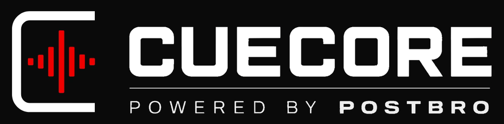
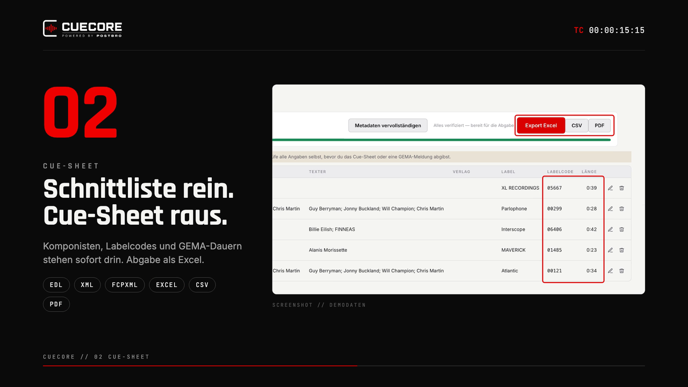
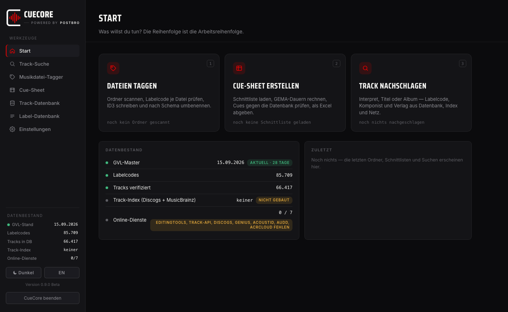

<b>Cue-Sheets für die GEMA, Labelcodes und Musik-Tagging für Schnitt und Postproduktion.</b> Kostenlos, Open Source, für Mac und Windows.

> **Open Beta 0.9.4, ein nicht-kommerzielles Projekt.** CueCore wird im Produktionsalltag benutzt, ist aber noch in der Erprobung. Bitte jede Angabe vor einer GEMA-Meldung selbst prüfen und Fehler melden (siehe [Feedback](#feedback)).

---

## Download

Aktuelle Version: **Beta 0.9.4** (0.9.4-beta). Herunterladen, entpacken, starten: alles ist dabei, auch die Datenbanken.

| System | Datei |
|---|---|
| Mac mit Apple-Chip (M1 und neuer), macOS 11 oder neuer | [CueCore_Beta-0.9.4_Mac.zip](https://github.com/PostBro/CueCore/releases/download/v0.9.4-beta/CueCore_Beta-0.9.4_Mac.zip) |
| Windows 10 und 11 (64 Bit), ohne Installation | [CueCore_Beta-0.9.4_Windows.zip](https://github.com/PostBro/CueCore/releases/download/v0.9.4-beta/CueCore_Beta-0.9.4_Windows.zip) |

> **Mac: macOS blockiert den ersten Start.** Die App ist nicht notarisiert. Meldung schließen (nicht in den Papierkorb legen), dann **Systemeinstellungen > Datenschutz & Sicherheit**, ganz nach unten scrollen, bei „CueCore wurde blockiert“ auf **„Dennoch öffnen“** klicken und mit Passwort oder Touch ID bestätigen. Das ist nur einmal nötig. Details unter [Installieren](#installieren).
>
> **Windows:** Bei „Der Computer wurde durch Windows geschützt“ auf „Weitere Informationen“, dann „Trotzdem ausführen“.

Alle Versionen und Änderungen unter [Releases](https://github.com/PostBro/CueCore/releases). Für Macs mit Intel-Prozessor gibt es noch keinen Build.

**Optional: Offline-Track-Index** (17 Millionen Tracks aus Discogs und MusicBrainz, 1,26 GB): in CueCore unter Einstellungen, „Lokaler Track-Index“, auf „Track-Index herunterladen“ klicken. Damit findet CueCore Labelcodes und Urheber auch ohne Netz; deine eigenen Tracks bleiben unberührt. CueCore läuft auch ohne. Von Hand geht es auch: [Archiv](https://github.com/PostBro/CueCore/releases/download/v0.9.1-beta/CueCore_Track-Index_2026-09.tar.xz) entpacken und `track_index.db` in den Datenordner legen.

## Was CueCore kann

 Erklärvideo, 30 Sekunden, mit Demodaten. Klick aufs Bild.

1. **Cue-Sheet aus der Schnittliste.** EDL (CMX3600, Avid Assemble List), Final-Cut-Pro-XML aus Premiere oder Resolve, FCPXML, Pro-Tools-Session-Text oder eine einfache Excel-/CSV-Liste einlesen. CueCore rechnet die GEMA-Dauern, sucht Interpret, Titel, Komponist, Verlag, Label und Labelcode in der Datenbank und im Netz und zeigt je Cue eine Ampel: grün steht fest, gelb ist ein Vorschlag, rot fehlt. Abgabe als Excel, CSV oder PDF, mit Rechterückruf-Codes.
2. **Musikdateien taggen.** Ordner scannen, Labelcode je Datei prüfen, ID3-Tags schreiben (Label, Labelcode) und nach dem Schema `Interpret - Titel - [Label_LC12345].mp3` umbenennen und einsortieren. Ohne bestätigten Labelcode wird nichts umbenannt. Jeder Schritt lässt sich rückgängig machen.
3. **Track nachschlagen.** Interpret, Titel oder Album eingeben und Labelcode, Komponist und Verlag aus Datenbank und Netz holen (MusicBrainz, Discogs, Deezer, Wikidata und weitere, siehe unten).
4. **Label-Datenbank.** Der offizielle GVL-Labelcode-Master (85.803 Codes, Stand 13.10.2026) mit Rechterückruf-Codes R1 bis R13. Ein neuer Stand lässt sich direkt aus dem PDF der GVL-Labelrecherche einspielen.
5. **Track-Datenbank.** 66.417 Tracks sind mitgeliefert, darunter Lieferungen von Production-Music-Libraries wie Cezame. Eigene Listen und Library-Lieferungen (CSV/Excel) lassen sich einlesen, Einträge bearbeiten, prüfen und löschen.

Oberfläche auf Deutsch und Englisch, hell und dunkel.

## Installieren

**Mac:** ZIP doppelklicken, `CueCore.app` in den Ordner Programme ziehen und starten. macOS blockiert den ersten Start, weil die App nicht notarisiert ist. Die Meldung schließen (nicht in den Papierkorb legen), dann Systemeinstellungen, Datenschutz & Sicherheit, ganz nach unten scrollen, bei „CueCore wurde blockiert“ auf „Dennoch öffnen“ klicken (je nach macOS-Version „Trotzdem öffnen“) und mit Passwort oder Touch ID bestätigen. Danach startet die App normal. Alternativ im Terminal: `xattr -d com.apple.quarantine /Applications/CueCore.app`

**Windows:** ZIP komplett entpacken (nicht aus der ZIP heraus starten), im Ordner `CueCore.exe` starten. Zeigt Windows „Der Computer wurde durch Windows geschützt“: „Weitere Informationen“, dann „Trotzdem ausführen“. CueCore braucht die WebView2-Runtime von Microsoft. Sie ist auf Windows 10 und 11 mit aktuellem Edge vorhanden; falls nicht, gibt es sie kostenlos bei Microsoft („WebView2 Runtime“).

Die Apps sind noch nicht mit einem Entwicklerzertifikat signiert, daher diese einmaligen Rückfragen.

**Firewall:** Beim ersten Nachschlagen im Netz fragen Little Snitch, LuLu und ähnliche Programme nach. „Erlauben“ wählen. Der Start selbst braucht kein Netz.

## Erste Schritte

1. **Zielordner festlegen.** Beim ersten Start fragt CueCore nach dem Ordner, in den getaggte Musikdateien wandern. Ändern lässt er sich später in den Einstellungen.
2. **Optional: weitere API-Schlüssel eintragen.** CueCore läuft sofort. Mit eigenen Schlüsseln für weitere Dienste findet es mehr: Einstellungen, je Dienst „Schlüssel holen“, einfügen, „Verbindung prüfen“ (siehe [API-Schlüssel](#api-schlüssel)).
3. **Cue-Sheet:** Tab „Cue-Sheet“, Schnittliste wählen oder ins Fenster ziehen. Gelbe und rote Zeilen mit „Metadaten vervollständigen“ im Netz nachschlagen, Vorschläge prüfen und übernehmen, dann exportieren.
4. **Tagger:** Tab „Musikdatei-Tagger“, Ordner wählen oder hineinziehen. Je Datei Vorschau ansehen, bei Bedarf ändern, dann „Taggen & verschieben“.
5. **Track-Suche:** Interpret und Titel eingeben. Treffer aus der Datenbank stehen sofort da, „Im Netz abgleichen“ holt weitere Quellen dazu.

Labelcodes kommen aus dem GVL-Master; Codes aus dem Netz zählen nur, wenn der Master sie kennt. Vorschläge aus dem Netz (etwa Komponisten) sind als Vorschlag markiert und werden erst gespeichert, wenn du die Zeile im Editor speicherst.

## API-Schlüssel

**AcoustID ist eingebaut, nur für nicht-kommerzielle Nutzung.** Die Erkennung am akustischen Fingerabdruck funktioniert ohne eigenen Schlüssel. Wer CueCore kommerziell nutzt, trägt einen eigenen AcoustID-Schlüssel ein; der eigene Schlüssel ersetzt dann den eingebauten.

Für alle anderen Online-Dienste trägst du eigene Schlüssel ein: Einstellungen, beim jeweiligen Dienst auf „Schlüssel holen“ (öffnet die API-Seite des Anbieters), Schlüssel einfügen, speichern und mit „Verbindung prüfen“ testen.

> **CueCore läuft am besten, wenn möglichst alle Schlüssel eingetragen sind.** Jeder Dienst ist eine weitere Quelle: mehr Treffer bei Labelcodes, Komponisten und Verlagen, und mit Fingerabdruck erkennt CueCore auch Dateien ohne Tags und ohne brauchbaren Namen. Die meisten Schlüssel sind kostenlos und in wenigen Minuten angelegt.

Ohne eigenen Schlüssel arbeiten bereits: MusicBrainz, Deezer, Wikidata, iTunes-Suche, musik-sammler.de und AcoustID (eingebaut, nicht-kommerziell).

| Dienst | Wofür | Schlüssel holen | Kosten laut Anbieter |
|---|---|---|---|
| Discogs | Labelcodes aus Releases, höheres Abfragelimit | [discogs.com/settings/developers](https://www.discogs.com/settings/developers) („Generate new token“) | kostenlos |
| Genius | Songwriter, wenn MusicBrainz und Discogs keine Autoren kennen | [genius.com/api-clients](https://genius.com/api-clients) („Generate Access Token“) | kostenlos, kommerzielle Nutzung nur mit Genius-Lizenz |
| AcoustID | Track am akustischen Fingerabdruck erkennen | eingebaut (nicht-kommerziell); eigener: [acoustid.org/new-application](https://acoustid.org/new-application) (Application Key) | kostenlos für nicht-kommerzielle Nutzung |
| AudD | Fingerprint-Alternative | [dashboard.audd.io](https://dashboard.audd.io) | nutzungsabhängig |
| ACRCloud | Fingerprint-Alternative | [console.acrcloud.com](https://console.acrcloud.com) | siehe Anbieter |
| editingtools.io | Production-Music-Cues im Cue-Sheet ergänzen | [editingtools.io](https://editingtools.io) (Account, API-Key) | kontingentbasiert |
| Track-API einer Library | Metadaten direkt von einer Library (z.B. Fresh Tracks) | Zugangsdaten bei der Library anfragen | nach Vereinbarung mit der Library |

Mit deinem eigenen Schlüssel nimmst du die Bedingungen des jeweiligen Anbieters an. AcoustID ist laut Anbieter nur für nicht-kommerzielle Nutzung kostenlos, das gilt auch für den eingebauten Zugang; für kommerzielle Nutzung bietet AcoustID OÜ einen Bezahlzugang ([acoustid.biz](https://acoustid.biz)). Genius erlaubt kommerzielle Nutzung nur mit eigener Lizenz.

## Daten und Datenschutz

- Alles bleibt auf deinem Rechner. Kein Konto, keine Anmeldung bei CueCore.
- Ins Netz gehen Suchbegriffe (Interpret, Titel, Album, ISRC, Labelcode) an die oben genannten Dienste. Erkennen Tags und Dateiname eine Musikdatei nicht, schickt CueCore ihren Fingerabdruck und die Dauer an AcoustID. Nur wenn du sie einrichtest: editingtools.io bekommt Dateinamen und Zeiten der Cues einer Schnittliste, eine Track-API die Dateinamen, AudD einen kurzen Audioausschnitt (ohne installiertes ffmpeg die ganze Datei).
- Eigene API-Schlüssel stehen nur lokal in `settings.json` im Datenordner.
- Datenordner: Mac `~/Library/Application Support/MusicMeta/`, Windows `%LOCALAPPDATA%\CueCore\`. Darin liegen Label- und Track-Datenbank, Einstellungen und das Protokoll `cuecore.log` (erste Anlaufstelle bei Fehlern). In den Einstellungen öffnet „Ordner öffnen“ ihn direkt; die App selbst wird nie verändert, ein Update ersetzt nur die App.
- Vor jeder automatischen Änderung an deinen Datenbanken (etwa beim ersten Start einer neuen Version) legt CueCore eine datierte Sicherung daneben (`*.sicherung-JJJJ-MM-TT_hhmmss.db`).

## Bekannt in der Beta

- Kein Build für Macs mit Intel-Prozessor.
- Rechterückrufe der GVL lassen sich nicht automatisch abfragen. CueCore zeigt die Codes aus dem Master; die Labelrecherche der GVL bleibt die verbindliche Quelle.
- Offene Punkte stehen unter [Issues](https://github.com/PostBro/CueCore/issues).

## Lizenz

CueCore ist freie Software unter der [GNU Affero General Public License v3.0](LICENSE). Du darfst es kostenlos nutzen, weitergeben und verändern; wer eine veränderte Fassung weitergibt oder als Dienst anbietet, muss deren Quellcode unter derselben Lizenz offenlegen. Die enthaltenen Komponenten, Schriften und Datenquellen mit ihren Lizenzen stehen in [LIZENZEN.md](LIZENZEN.md). Den Quellcode selbst starten, testen oder die Apps bauen: [docs/ENTWICKLUNG.md](docs/ENTWICKLUNG.md).

Keine Gewähr: CueCore ersetzt nicht die Prüfung von Labelcodes, Rechterückrufen und Urheberangaben vor einer Meldung.

## Feedback

Fehler, Fragen, Wünsche: [Issues](https://github.com/PostBro/CueCore/issues) oder [info@postbro.tv](mailto:info@postbro.tv). Bei Fehlern bitte Version (unten in der Seitenleiste), System und, wenn möglich, `cuecore.log` aus dem Datenordner mitschicken.

---

**English:** CueCore is a free, open-source desktop app for film and TV editors and music rights people in Germany: it turns edit decision lists (EDL, FCP XML, FCPXML, Pro Tools text, Excel/CSV) into GEMA cue sheets, looks up GVL label codes, composers and publishers, and tags and renames music files (ID3, label code). Label codes come from the official GVL master (85,803 codes); 66,417 tracks are included; an optional offline index with 17 million tracks from Discogs and MusicBrainz is a separate download. Interface in German and English. Open beta 0.9.4, a non-commercial project, for Mac (Apple silicon) and Windows; AcoustID fingerprinting is built in for non-commercial use. Licensed under AGPL-3.0.
